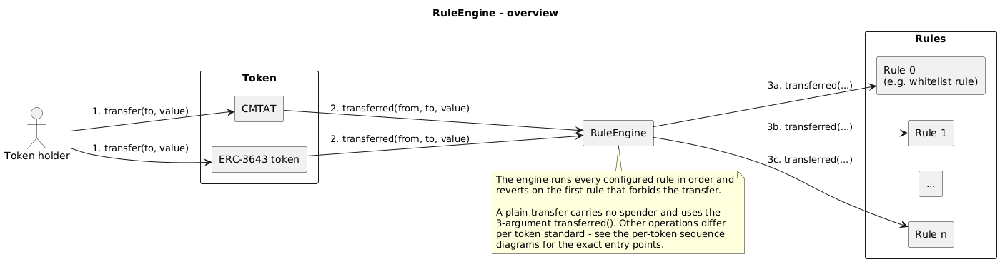

# RuleEngine

RuleEngine applies transfer restrictions to [CMTAT](https://github.com/CMTA/CMTAT) and [ERC-3643](https://eips.ethereum.org/EIPS/eip-3643) tokens.

It is an *external controller*: the token calls the engine on every transfer, mint and burn, and the engine forwards the call to a configurable list of pluggable rule contracts. This keeps compliance logic out of the token, lets each issuer compose the rules they need, and avoids growing the token's already large bytecode.

- **Version:** 3.0.0-rc7 (`version()` returns `"3.0.0-rc7"`)
- **Solidity:** ^0.8.27 (compiled with 0.8.37; 0.8.27 is the first version supporting `require` with a custom error on the legacy pipeline)
- **EVM target:** Osaka (Fusaka upgrade)
- **License:** MPL-2.0

**Full documentation: [doc/README.md](./doc/README.md)** — interfaces, Ethereum API, deployment, UML and call graphs, audits, and toolchain usage.

> This project has not undergone an audit and is provided as-is without any warranties.

## Contract Variants

Six deployable contracts share the same core logic and differ only in access control and ERC-2771 support. Each access-control model comes in two versions: without ERC-2771, and with an immutable trusted forwarder (`*2771`):

| Contract | Access Control | ERC-2771 (gasless) | Use Case |
|----------|---------------|--------------------|----------|
| `RuleEngine` | Role-based (`AccessControlEnumerable`) | No | Multi-operator environments with granular permissions |
| `RuleEngine2771` | Role-based (`AccessControlEnumerable`) | Yes (immutable trusted forwarder) | Same, with administration through meta-transactions |
| `RuleEngineOwnable` | ERC-173 `Ownable` | No | Single-owner setups, simpler administration |
| `RuleEngineOwnable2771` | ERC-173 `Ownable` | Yes (immutable trusted forwarder) | Same, with administration through meta-transactions |
| `RuleEngineOwnable2Step` | ERC-173 `Ownable2Step` | No | Single-owner setups with safer ownership handover |
| `RuleEngineOwnable2Step2771` | ERC-173 `Ownable2Step` | Yes (immutable trusted forwarder) | Same, with administration through meta-transactions |

All of them support ERC-1404 transfer restrictions, the ERC-3643 compliance interface and multiple token bindings.

> **Warning (shared engine across multiple tokens):** one RuleEngine instance can be bound to several tokens, but they must be equally trusted and governed together. ERC-3643 callbacks do not pass the token address to rules, so stateful rules are not safe for mutually untrusted tokens sharing an engine.

## How it works



The token calls the engine on every transfer, mint and burn. The engine checks the caller is a bound token, then runs each configured rule in order. A rule that forbids the transfer reverts, and the whole transaction reverts with it — remaining rules are never reached.

**CMTAT and ERC-3643 use disjoint entry points.** The 4-argument overload is declared by CMTAT's `IRuleEngine`, so an ERC-3643 token never reaches it; `created` / `destroyed` belong to `IERC3643Compliance`, and CMTAT never calls them.

| Token | Transfer | `transferFrom` | Mint | Burn |
|-------|----------|----------------|------|------|
| CMTAT | `transferred(from, to, value)` | `transferred(spender, …)` | `transferred(spender, …)` | `transferred(spender, …)` |
| ERC-3643 | `transferred(from, to, value)` | `transferred(from, to, value)` | `created(to, value)` | `destroyed(from, value)` |

CMTAT picks the overload according to whether the operation has a spender. A plain `transfer` has none, so CMTAT calls the 3-argument `transferred(from, to, value)` — the engine is never called with a zero spender. `transferFrom`, `mint` and `burn` do have one (`_msgSender()`), so those call the 4-argument `transferred(spender, from, to, value)` — as do `batchMint`, `batchBurn`, `burnFrom`, cross-chain mint/burn and the minter `batchTransfer` (where `spender == from`). CMTAT's `forcedTransfer` does not call the engine at all. Whichever entry point is used, the engine then runs the same rule loop. The complete per-operation table is in [doc/technical/RuleEngine-with-CMTAT.md](./doc/technical/RuleEngine-with-CMTAT.md#2-which-entry-points-cmtat-uses).

The view path, `detectTransferRestriction()`, iterates the same rules and returns the first non-zero ERC-1404 restriction code instead of reverting.

Sequence diagrams for each token type: [CMTAT](./doc/schema/plantuml/ruleengine-flow-cmtat.png) — [ERC-3643](./doc/schema/plantuml/ruleengine-flow-erc3643.png) (sources in [doc/schema/plantuml](./doc/schema/plantuml/)).

## Architecture

```
RuleEngineBase (abstract)              — core logic, shared by all variants
├── VersionModule                      — version()
├── RulesManagementModule              — add/remove/set/clear rules, maxRules cap
├── ERC3643ComplianceExtendedModule    — ERC-3643 flavour of the binding registry
│   ├── ERC3643ComplianceModule        — getTokenBound(), compliance manager hook
│   │   └── TokenBindingModule         — bind/unbind tokens (standard-agnostic)
│   └── TokenBindingExtendedModule     — batch binding, token self-binding
└── IRuleEngineERC1404                 — CMTAT interface

RuleEngine                 = RuleEngineBase          + AccessControlEnumerable
RuleEngine2771             = RuleEngine              + ERC2771ModuleStandalone
RuleEngineOwnable          = RuleEngineOwnableShared + Ownable
RuleEngineOwnable2771      = RuleEngineOwnable       + ERC2771ModuleStandalone
RuleEngineOwnable2Step     = RuleEngineOwnableShared + Ownable2Step
RuleEngineOwnable2Step2771 = RuleEngineOwnable2Step  + ERC2771ModuleStandalone
```

Token binding is deliberately split in two layers: `TokenBindingModule` / `TokenBindingExtendedModule` hold the whole registry (storage, `bindToken` / `unbindToken` / `isTokenBound`, batch binding, self-binding, the `onlyBoundToken` guard) and depend on nothing but OpenZeppelin, so they can be reused by any project that has to bind tokens; `ERC3643ComplianceModule` / `ERC3643ComplianceExtendedModule` are thin ERC-3643 adapters on top, adding `getTokenBound()` and the compliance-manager vocabulary. `src/mocks/TokenBindingStandaloneMock.sol` shows the registry used on its own, outside any compliance context.

Modules declare access control as **virtual internal hooks** (`_onlyRulesManager`, `_onlyComplianceManager`, `_onlyRulesLimitManager`); each deployable contract overrides them with either RBAC roles or `onlyOwner`. Rules and bound tokens are stored in OpenZeppelin `EnumerableSet.AddressSet` for O(1) add/remove/contains plus iteration.

## Repository layout

```
src/
├── RuleEngineBase.sol              # abstract core logic (not deployable)
├── RuleEngineOwnableShared.sol     # shared logic for the two ownable variants
├── deployment/                     # the six deployable contracts, one directory per access-control model
│   ├── accessControl/              # RBAC (AccessControlEnumerable)
│   │   ├── RuleEngine.sol
│   │   └── RuleEngine2771.sol
│   └── ownable/                    # ERC-173 (Ownable / Ownable2Step)
│       ├── RuleEngineOwnable.sol
│       ├── RuleEngineOwnable2771.sol
│       ├── RuleEngineOwnable2Step.sol
│       └── RuleEngineOwnable2Step2771.sol
├── interfaces/                     # IRule, IRulesManagementModule, ITokenBinding(Extended),
│                                   # IERC3643Compliance(Extended)
├── modules/                        # VersionModule, RulesManagementModule, TokenBinding(Extended)Module,
│   │                               # ERC3643Compliance(Extended)Module, ERC2771ModuleStandalone
│   └── library/                    # invariant storage (errors/events), role constants, interface IDs
└── mocks/                          # reference rules and test doubles — not for production

test/                               # Foundry tests, one directory per deployable variant
script/                             # Foundry deployment / example scripts
doc/                                # full documentation, schemas, coverage, audits
```

**Key invariant:** rule contracts under `src/mocks/` are reference implementations for testing and examples. Production rules live in a separate repository.

## Rules

Production rules are maintained at [github.com/CMTA/Rules](https://github.com/CMTA/Rules), in two families:

- **Validation rules (read-only)** — evaluate eligibility without mutating state: `RuleWhitelist`, `RuleWhitelistWrapper`, `RuleReceiverWhitelist`, `RuleBlacklist`, `RuleSanctionsList`, `RuleIdentityRegistry`, `RuleSpenderWhitelist`, `RuleERC2980`, `RuleMaxTotalSupply` / `RuleMaxTotalSupplyERC3643`, `RuleMaxBalance`, `RuleChainlinkPoR` / `RuleChainlinkPoRERC3643`
- **Operation rules (read-write)** — may update rule state on transfer: `RuleConditionalTransferLight`, `RuleMintAllowance`, and `RuleConditionalTransferLightMultiToken` (set directly on each token, never behind a RuleEngine)

The Rules repository is the source of truth for this list; see [doc/README.md § Available Rules](./doc/README.md#available-rules) for details and caveats.

To be usable by the engine, a rule must implement `IRule` and advertise it through ERC-165 (`0xb1a69752` since v3.0.0-rc7; the older `0x2497d6cb`, which also covers `canTransfer` / `canTransferFrom`, is still accepted). Restriction codes should stay unique across the composed rule set.

## Quick start

Dependencies are git submodules.

```bash
git submodule update --init   # non-recursive is enough: remappings.txt resolves OpenZeppelin
                              # to this repo's own submodules, including for the CMTAT sources

forge build       # compile
forge test        # run the test suite
FOUNDRY_PROFILE=erc3643 forge test   # tests against the real ERC-3643 token (T-REX 4.2.0-beta1, solc 0.8.30)
forge coverage    # code coverage
forge fmt         # format
```

`--recursive` and `cd lib/CMTAT && npm install` are only needed to run CMTAT's own Hardhat suite from inside `lib/CMTAT`.

See [doc/README.md](./doc/README.md) for deployment scripts, the production deployment checklist, and Hardhat usage.

Parts of this project were written with the help of AI coding assistants, principally Claude Code (Anthropic) and Codex (OpenAI).

## Security

- Vulnerability disclosure: [SECURITY.md](https://github.com/CMTA/CMTAT/blob/master/SECURITY.md) (CMTAT main repository)
- v1.0.2 was audited by [ABDK Consulting](https://www.abdk.consulting/) in March 2022; the current 3.0.0 line has **not** been audited
- Static-analysis reports (Slither, Aderyn, Nethermind AuditAgent) are in [doc/security](./doc/security/)

## Intellectual property

The code is copyright (c) Capital Market and Technology Association, 2022-2026, and is released under [Mozilla Public License 2.0](https://github.com/CMTA/CMTAT/blob/master/LICENSE.md).
