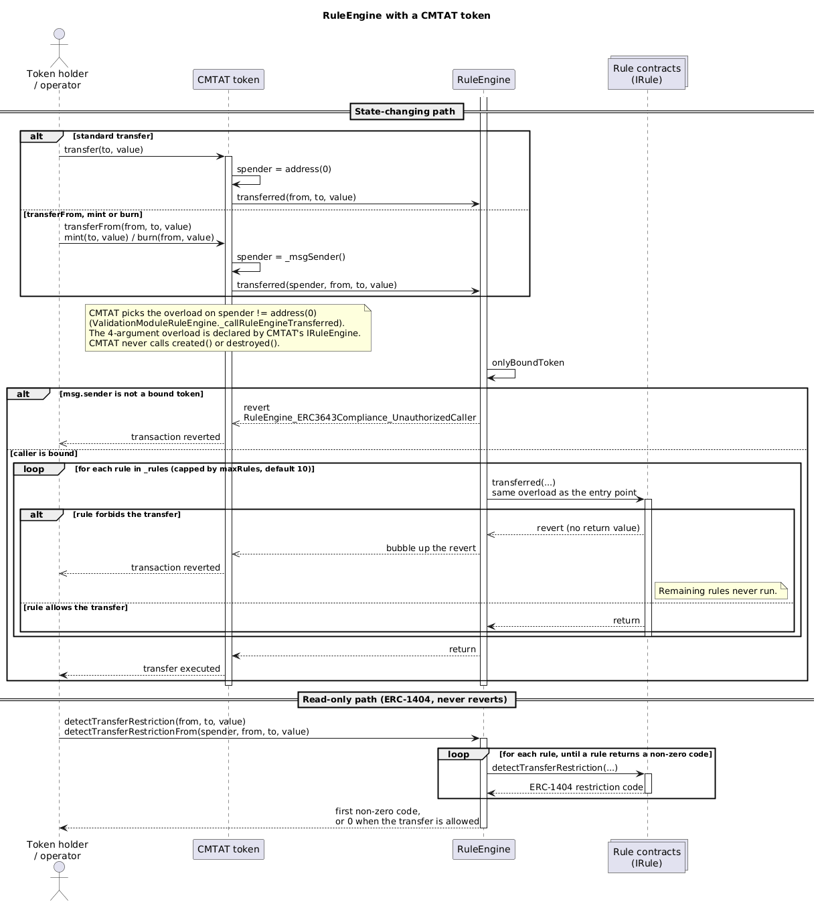

# Using the RuleEngine with a CMTAT token

How to attach a RuleEngine to a [CMTAT](https://github.com/CMTA/CMTAT) token, which entry points CMTAT
actually calls, how to configure both sides, and the limitations to know about before deploying.

For the ERC-3643 equivalent, see [RuleEngine-with-ERC3643.md](./RuleEngine-with-ERC3643.md). The two token
standards drive **disjoint entry points** on the engine, so a rule or an integration written against one does
not automatically hold for the other.

## 1. Flow



_Diagram source: [doc/schema/plantuml/ruleengine-flow-cmtat.puml](../schema/plantuml/ruleengine-flow-cmtat.puml)._

## 2. Which entry points CMTAT uses

CMTAT calls **`transferred`** for every state-changing operation, and picks between two overloads according to whether the operation has a spender.

The choice is made in
`ValidationModuleRuleEngine._callRuleEngineTransferred`:

```solidity
if (spender != address(0)) {
    ruleEngine_.transferred(spender, from, to, value);   // 4-argument
} else {
    ruleEngine_.transferred(from, to, value);            // 3-argument
}
```

The `spender` value comes from `CMTATBaseCommon`. Every CMTAT path that reaches the engine (CMTAT v3.3.0):

| CMTAT operation | `spender` passed | `from` | `to` | Overload called |
|---|---|---|---|---|
| `transfer(to, value)` | `address(0)` | holder | recipient | **3-argument** `transferred(from, to, value)` |
| `transferFrom(from, to, value)` | `_msgSender()` | holder | recipient | 4-argument `transferred(spender, from, to, value)` |
| `mint`, `batchMint`, `crosschainMint`, mint leg of `burnAndMint` | operator (`_msgSender()`) | `address(0)` | recipient | 4-argument |
| `burn`, `batchBurn`, `burnFrom`, self `burn(uint256)`, `crosschainBurn`, burn leg of `burnAndMint` | operator (`_msgSender()`) | holder | `address(0)` | 4-argument |
| minter `batchTransfer(tos, values)` | minter (`_msgSender()`) | **minter** | recipient | 4-argument, **`spender == from`** |
| `forcedTransfer` (enforcer) | — | — | — | **not called** |

Points to note in this table:

- **`spender == from`** happens on two paths: the minter `batchTransfer` and a holder calling
  `transferFrom` on its own tokens. A rule that screens the spender screens the minter a second time there.
- **`burn` and `burnFrom` are indistinguishable** to the engine: both arrive as `(operator, holder, address(0), value)`.
- **`forcedTransfer` bypasses the engine.** Stateful rules are not notified and observing rules are not
  consulted. This differs from ERC-3643 T-REX, whose `forcedTransfer` notifies the compliance contract.

The reference list is CMTAT's own [`doc/technical/ruleengine-integration.md`](https://github.com/CMTA/CMTAT/blob/v3.3.0-rc4/doc/technical/ruleengine-integration.md) (§"Runtime Call Flow"), whose routing is pinned by CMTAT's `RuleEngineSpenderDispatchCommon.js` tests.

Two consequences follow:

- A **plain transfer never carries a spender**. The zero address is a branch condition inside CMTAT and is
  never forwarded, so the engine is never called with a zero spender.
- Since CMTAT v3.3.0, **mint, burn and the minter `batchTransfer` go through the 4-argument overload** with the operator as `spender` (documented in the `IRuleEngine.transferred` NatSpec since CMTAT v3.3.0-rc4).
  A rule that rejects unknown spenders must skip or adapt that check when `from == address(0)` (mint) or `to == address(0)` (burn), or it will block issuance and redemption.
- **On CMTAT v3.0.0 – v3.2.0, mint, burn and the minter transfer arrive on the 3-argument overload**
  (`_checkTransferred(address(0), ...)` in `lib/CMTATv3.0.0/contracts/modules/0_CMTATBaseCommon.sol`). The engine
  works with these versions, but a spender-keyed rule (a per-minter mint allowance, minter screening) is inert
  there: it never sees the operator. See [CMTAT v3.0.0](#cmtat-v300).

**CMTAT never calls `created()` or `destroyed()`.** Those belong to `IERC3643Compliance` and are used only by ERC-3643 tokens. 

The 4-argument `transferred` is conversely declared by CMTAT's `IRuleEngine` and is never
reached by an ERC-3643 token.

### CMTAT v3.0.0

CMTAT v3.0.0 is the last audited CMTAT release, and the oldest one the engine supports. It is pinned as the
submodule `lib/CMTATv3.0.0` (remapped `CMTATv3.0.0/`) so the engine is tested against it.

The engine is unchanged: the token sets it with `setRuleEngine(IRuleEngine)` and calls the same two overloads,
chosen by the same `spender != address(0)` branch (`ValidationModuleRuleEngine._transferred` in v3.0.0). What
differs is the spender CMTAT passes. In v3.0.0 (`modules/0_CMTATBaseCommon.sol`) only `transferFrom` carries
one; mint, burn and the minter transfer call `_checkTransferred(address(0), ...)`:

| CMTAT v3.0.0 operation | `spender` passed | `from` | `to` | Overload called |
|---|---|---|---|---|
| `transfer(to, value)` | `address(0)` | holder | recipient | 3-argument |
| `transferFrom(from, to, value)` | `_msgSender()` | holder | recipient | 4-argument |
| `mint`, `batchMint`, `crosschainMint` | `address(0)` | `address(0)` | recipient | **3-argument** (4-argument since v3.3.0) |
| `burn`, `batchBurn`, `burnFrom`, `crosschainBurn` | `address(0)` | holder | `address(0)` | **3-argument** (4-argument since v3.3.0) |
| minter `batchTransfer(tos, values)` | `address(0)` | minter | recipient | **3-argument** (4-argument since v3.3.0) |
| `forcedTransfer` | — | — | — | not called |

Consequences for an integrator on v3.0.0 – v3.2.0:

- **Spender-keyed rules are inert on mint and burn.** A rule that acts only on the 4-argument path, such as a
  per-minter mint allowance (`RuleMintAllowance` in the Rules repository), never sees the operator, so it
  neither debits nor blocks a mint. Minter screening by a deny-list does not happen either.
- **Rules enforced on the 3-argument path still apply to mint and burn**, with `from == address(0)` for a mint
  and `to == address(0)` for a burn, exactly as on an ERC-3643 token.
- **`transferFrom` is the only operation with a spender**, so a spender whitelist screens it as on later
  versions.

Pinned by `RuleEngine/RulesManagementModuleTest/CMTATOperationRoutingV3.t.sol` (10 tests): for `transfer`,
`transferFrom`, `mint` and `burn`, the exact overload and arguments reaching the engine and the rule
(`vm.expectCall`), and the absence of the other overload. A rule rejecting that overload blocks each operation,
and a rule enforced only on the 4-argument path lets mint and burn through. The other `…V3` suites (§5) run
the integration and whitelist tests against the same v3.0.0 token.

### Read-only path

CMTAT exposes the ERC-1404 view path, which the engine answers by iterating the same rules and returning the **first non-zero** restriction code:

- `detectTransferRestriction(from, to, value)` / `canTransfer(from, to, value)`
- `detectTransferRestrictionFrom(spender, from, to, value)` / `canTransferFrom(spender, from, to, value)`
- `messageForTransferRestriction(code)` — resolves the code against the rule that claims it

**Pre-flighting a mint or a burn.** The engine and every rule read `from == address(0)` as a mint and
`to == address(0)` as a burn. The **token's** `detectTransferRestriction*` does not: CMTAT scopes it to
`transfer` / `transferFrom` and answers, for example, `TRANSFER_REJECTED_PAUSED` for `from == address(0)` while
paused, although `mint` proceeds while paused (see the header of CMTAT's `ValidationModuleERC1404.sol`). To
predict a mint or a burn, call `canTransfer*` on the token, which branches on the zero address, or
`detectTransferRestriction*` on the engine directly — not `detectTransferRestriction*` on the token.

## 3. Configuration

### 3.1 Deploy the RuleEngine

Six deployable variants share identical core logic and differ only in access control and ERC-2771 support. Pick one:

| Contract | Access control | Use case |
|---|---|---|
| `RuleEngine` | Role-based (`AccessControlEnumerable`), no ERC-2771 | Multiple operators, granular permissions |
| `RuleEngine2771` | Role-based, with an immutable ERC-2771 forwarder | Same, administered through meta-transactions |
| `RuleEngineOwnable` | ERC-173 `Ownable`, no ERC-2771 | Single owner |
| `RuleEngineOwnable2771` | ERC-173 `Ownable`, with an immutable ERC-2771 forwarder | Single owner, meta-transactions |
| `RuleEngineOwnable2Step` | ERC-173 `Ownable2Step`, no ERC-2771 | Single owner, safer handover |
| `RuleEngineOwnable2Step2771` | ERC-173 `Ownable2Step`, with an immutable ERC-2771 forwarder | Single owner, safer handover, meta-transactions |

```solidity
// admin, token to bind (may be address(0))
RuleEngine engine = new RuleEngine(admin, address(0));
// admin, trusted ERC-2771 forwarder, token to bind (may be address(0))
RuleEngine2771 engine2771 = new RuleEngine2771(admin, forwarder, address(0));
```

The forwarder is **immutable** — it is fixed at construction and cannot be changed afterwards. The ownable
variants follow the same pattern: `RuleEngineOwnable(owner, token)` / `RuleEngineOwnable2771(owner, forwarder, token)`,
and likewise for `RuleEngineOwnable2Step` / `RuleEngineOwnable2Step2771`.

### 3.2 Bind the token to the engine

Only bound tokens may call `transferred`. Binding is a privileged operation on the engine:

```solidity
engine.bindToken(address(cmtat));    // COMPLIANCE_MANAGER_ROLE, or owner on the ownable variants
```

You can also pass the token as the third constructor argument to bind it at deployment.

CMTAT does **not** self-bind — unlike ERC-3643's `setCompliance`, `setRuleEngine` does not call back into the engine. Binding is therefore always an explicit operator action, and the self-binding approval mechanism (`setTokenSelfBindingApproval`) is not needed for CMTAT.

### 3.3 Point the token at the engine

Either at construction:

```solidity
ICMTATConstructor.Engine memory engines = ICMTATConstructor.Engine(IRuleEngine(address(engine)));
```

or afterwards, from `ValidationModuleRuleEngine`:

```solidity
cmtat.setRuleEngine(IRuleEngine(address(engine)));   // caller needs DEFAULT_ADMIN_ROLE on the token
```

### 3.4 Add rules

```solidity
engine.addRule(IRule(address(rule)));                  // RULES_MANAGEMENT_ROLE, or owner
engine.setRules(rulesArray);                           // replaces the whole set atomically
```

A rule must implement `IRule` and advertise `RuleInterfaceId.IRULE_INTERFACE_ID` (`0xb1a69752`) through ERC-165, or the pre-rc7 `IRULE_LEGACY_INTERFACE_ID` (`0x2497d6cb`); the engine validates this on `addRule` and rejects anything else. The rules of [CMTA/Rules](https://github.com/CMTA/Rules) up to v0.6.0 advertise the legacy ID. Rules run **in declaration order** and the first one to revert aborts the whole transaction.

The operation rules of CMTA/Rules accept `transferred` only from a caller bound on the rule itself, so tell them about the engine before the first transfer:

```solidity
conditionalTransfer.bindToken(address(token));        // RuleConditionalTransferLight
conditionalTransfer.bindRuleEngine(address(engine));   //   ... and the engine that relays the token
mintAllowance.bindToken(address(engine));              // RuleMintAllowance: the engine is its caller
```

`RuleConditionalTransferLightMultiToken` is the exception: it is never added to an engine (see [doc/README.md §Available Rules](../README.md#available-rules)).

### 3.5 Roles reference (`RuleEngine` variant)

| Role | Grants |
|---|---|
| `DEFAULT_ADMIN_ROLE` | Everything (the `hasRole` override makes the admin hold all roles), plus `setMaxRules` |
| `RULES_MANAGEMENT_ROLE` | `addRule`, `removeRule`, `setRules`, `clearRules` |
| `COMPLIANCE_MANAGER_ROLE` | `bindToken`, `unbindToken`, and the batch variants |

On `RuleEngineOwnable` / `RuleEngineOwnable2Step` all three collapse to `onlyOwner`.

## 4. Warnings and limitations

### 4.1 The rule set is iterated on every transfer

Every configured rule is called on every transfer, mint, burn **and** on every view call. Cost is O(number of rules). 

An on-chain cap (`maxRules`, default **10**) bounds this; raising it re-exposes unbounded gas cost for
administrative operations such as `clearRules`. 

A single gas-heavy or misconfigured rule can make all transfers fail.

### 4.2 The 3-argument view path fails open for spender-dependent rules

`detectTransferRestriction` and `canTransfer` carry no `spender`. A rule keyed by spender — a per-minter mint allowance, a spender whitelist — cannot evaluate the operation on that path and must answer "no restriction".
The engine aggregates that answer, so **these two views can report an operation as allowed that the state-changing path will revert**.

Use the 4-argument `detectTransferRestrictionFrom` / `canTransferFrom` to pre-check anything with an operator. Recorded as finding `H-1` in [CLAUDE_ANALYSIS.md](../security/audits/tools/v3.0.0-rc5/CLAUDE_ANALYSIS.md).

### 4.3 Address-list rules treat `address(0)` as a participant

**This concerns `RuleWhitelistMock`, a reference rule in `src/mocks/`, not a production rule.** Production rules live in [CMTA/Rules](https://github.com/CMTA/Rules) and may handle the sentinel differently — check the
rule you actually deploy.

`RuleWhitelistMock` checks both endpoints without exempting the zero-address sentinel. Because CMTAT routes mint through the 4-argument overload with `from == address(0)`, and the whitelist's `from`/`to` checks still apply, **the zero address must be whitelisted for minting to be permitted**.

Whitelisting only real holders silently blocks issuance. Recorded as finding `F-2`.

### 4.4 One engine shared by several tokens is not neutral

An engine can be bound to multiple tokens, but the ERC-3643 callbacks **do not pass the token address to the rules**. 

Any stateful rule that keeps per-address accounting therefore mixes state across every bound token.

Only bind tokens that are equally trusted and governed together. Unbinding does not retroactively separate state already accumulated.

Some rules of [CMTA/Rules](https://github.com/CMTA/Rules) cannot be shared at all:

- `RuleMaxTotalSupply`, `RuleChainlinkPoR` (and their ERC-3643 variants) and `RuleMaxBalance` read `totalSupply()` / `balanceOf()` from a token set at deployment, not from the token that triggered the check. Behind an engine bound to several tokens, every token is checked against that one token's supply or balances. Deploy one instance per token, in an engine dedicated to that token.
- `RuleConditionalTransferLight` keys approvals `(from, to, value)` with no token dimension: an approval recorded for one token can be consumed by a transfer of another. Bind it only to an engine that serves a single token.

### 4.5 Restriction codes must be unique across the rule set

The engine returns the first non-zero code, and `messageForTransferRestriction` resolves a code against the first rule claiming it. 

If two rules share a code they must return the same message, or operators get inconsistent feedback. Keep the CMTAT-reserved ranges free.

### 4.6 Rules are trusted code

Rule contracts are called on every transfer and can revert or consume arbitrary gas. Treat them as trusted business logic. 

**Rule `transferred*` hooks must not make a state-changing external call.** Only three CMTAT variants
(Standard, Snapshot and ERC-7551) wrap the `transferred` callback in a reentrancy guard; on the six others
(Debt, DebtEngine, Permit, UUPS, ERC-1363 and HolderList), CMTAT's safety rests on the trust model: the
engine, its rules and every contract they call must not hand control to untrusted code during
`transferred(...)`. The engine forwards the call to every rule, so the obligation lands on rule authors: a hook
may update the rule's own storage, but external reads (oracle, registry, price feed, token) must be `view`
calls, which run as `STATICCALL` and cannot re-enter the token. A called contract that reverts still blocks the
operation and the token's views, so it is trusted for availability too. See CMTAT's
[`ruleengine-integration.md`](https://github.com/CMTA/CMTAT/blob/v3.3.0-rc4/doc/technical/ruleengine-integration.md) §"Deployment Coverage".

Do not grant `RULES_MANAGEMENT_ROLE` to a rule contract — the engine blocks granting any role
to an address currently configured as a rule, but the check is one-directional and does not stop an already privileged address from later being added as a rule. The ownable variants apply the same check to a new owner, and `RuleEngineOwnable2Step` applies it both when the owner is nominated and when it accepts. Binding is checked in both directions: a current rule cannot be bound as a token, and a bound token cannot be added as a rule.

### 4.7 The trusted forwarder cannot act as a token

The three `*2771` deployables inherit `ERC2771Context` (the others have no forwarder at all), but the bound-token gate (`onlyBoundToken`, on `transferred`,
`created` and `destroyed`) compares the raw **`msg.sender`**, not `_msgSender()`. CMTAT calls the engine directly
from its own transfer, mint and burn, never through a forwarder, so nothing changes for a real token. A forwarder
that appends a bound token's address, however, is rejected with `TokenBinding_UnauthorizedCaller`.

This has been the case since v3.0.0-rc7. Before that, the gate used `_msgSender()`, and a trusted forwarder could
reach `transferred` "as" a bound token and drive stateful rules with no token movement: for example, consuming a
per-minter mint quota with no mint. This follows CMTAT's integration guide, which recommends `msg.sender` for this
check. Administrative calls still resolve through `_msgSender()`, so gasless administration keeps working. Use a
signature-verifying ERC-2771 forwarder, or deploy the contract without the `2771` suffix if gasless administration
is not needed. Details:
[doc/README.md §Gasless support](../README.md#gasless-support-erc-2771).

### 4.8 A single rule can be the token's rule engine

Since v3.0.0-rc7, `IRule` requires only what the engine calls, so it no longer includes `canTransfer` /
`canTransferFrom`. A rule that also wants this role implements CMTAT's `IRuleEngineERC1404` on top of `IRule`
and advertises `RULE_ENGINE_INTERFACE_ID`, as the four reference rules and every rule of [CMTA/Rules](https://github.com/CMTA/Rules) do. An issuer who needs exactly one rule can therefore skip the RuleEngine and
call `token.setRuleEngine(rule)`. CMTAT's `setRuleEngine` performs no ERC-165 check, so the token accepts any
contract with the right functions. The token then calls the rule directly: `transferred` (3- or 4-argument,
see §2), `canTransfer` / `canTransferFrom`, and the ERC-1404 views `detectTransferRestriction(From)` and
`messageForTransferRestriction`. This is the only configuration in which a rule's `canTransfer` /
`canTransferFrom` are called; behind a RuleEngine the engine computes them from `detectTransferRestriction*`.

What changes compared to a rule behind an engine, and what a rule must do to support the role:

- **There is no bound-token gate in front of the rule.** Behind an engine, only a bound token reaches the
  rules. Standalone, the token calls the rule, and so can anyone else: `transferred` is a public function of the
  rule. **A stateful rule must restrict who may call `transferred`** (its token when standalone, its engine
  otherwise), or any account can consume its state, for example a transfer approval or a minter's allowance,
  and block the real operation. The operation rules of CMTA/Rules do this: their hooks accept only the token
  bound on the rule (`bindToken`), plus, for `RuleConditionalTransferLight`, an engine bound with
  `bindRuleEngine`. The reference rules `RuleConditionalTransferLightMock` and `RuleMintAllowanceMock` do
  **not**: they are test doubles, not production rules. Note that the same exposure exists behind an engine,
  since a direct call to the rule never goes through the engine at all.
- **`canTransfer` / `canTransferFrom` must agree with `detectTransferRestriction*`.** The token answers
  `canTransfer` from the rule's own function, not from the restriction code, so a stub that returns a constant
  makes the token report a wrong answer.
- **The rule's codes and messages are the token's.** No engine stands in between to aggregate them, so the
  token's `detectTransferRestriction` and `messageForTransferRestriction` return the rule's values unchanged
  (after CMTAT's own codes: paused, deactivated, frozen).
- **One rule only.** Several restrictions need a RuleEngine.
- **CMTAT only.** An ERC-3643 token calls `created` / `destroyed` and the binding functions, which the
  validation rules do not implement, so a rule cannot replace the engine for an ERC-3643 token. CMTA/Rules
  recommends an engine for every ERC-3643 setup.

Tested with each reference rule in `test/RuleStandalone/RuleStandaloneCMTAT.t.sol`: allowed and refused
transfers with the rule's code and message, the spender check on `transferFrom`, a conditional-transfer approval
consumed once, a mint allowance consumed by `mint`, and a reverting rule blocking the transfer.

## 5. What is tested

| Area | File | Tests |
|---|---|---|
| Engine + CMTAT (current) | `RuleEngine/RulesManagementModuleTest/CMTATIntegration.t.sol` | 3 |
| Engine + CMTAT v3.0.0 | `RuleEngine/RulesManagementModuleTest/CMTATIntegrationV3.t.sol` | 3 |
| Whitelist rule + CMTAT (current) | `RuleWhitelist/CMTATIntegration.t.sol` | 11 |
| Whitelist rule + CMTAT v3.0.0 | `RuleWhitelist/CMTATIntegrationV3.t.sol` | 11 |
| Reverting rule propagation | `RuleEngine/RulesManagementModuleTest/RuleEngineOperationRevert.t.sol` | 1 |
| Reverting rule, CMTAT v3.0.0 | `RuleEngine/RulesManagementModuleTest/RuleEngineOperationRevertV3.t.sol` | 1 |
| Overload per operation (transfer, transferFrom, mint, burn), CMTAT v3.0.0 | `RuleEngine/RulesManagementModuleTest/CMTATOperationRoutingV3.t.sol` | 10 |
| Deployment script | `script/CMTATWithRuleEngineScript.t.sol` | 1 |
| A rule as the token's engine, no RuleEngine (§4.8) | `RuleStandalone/RuleStandaloneCMTAT.t.sol` | 9 |

**50 CMTAT-specific tests.** Coverage includes: a real `CMTATStandardStandalone` bound to the engine, transfers accepted and rejected through the whitelist, restriction-code propagation back to the token, and a rule that reverts mid-transfer.

**Backward compatibility is tested against two CMTAT versions.** The `…V3` suites deploy a real CMTAT **v3.0.0** token (submodule `lib/CMTATv3.0.0`, remapped `CMTATv3.0.0/`) alongside the current **v3.3.0-rc4** token (`lib/CMTAT`). 

Both are bound to the same engine implementation.

### Version compatibility

| RuleEngine | CMTAT |
|---|---|
| v3.0.0-rc7 | ≥ v3.0.0, target v3.3.0-rc4 |
| v3.0.0-rc6 | ≥ v3.0.0, target v3.3.0-rc3 |
| v3.0.0-rc5 | ≥ v3.0.0, target v3.3.0-rc3 |
| v3.0.0-rc4 | ≥ v3.0.0, target v3.3.0-rc1 |
| v1.0.2.1 | v2.3.0 (audited) |

## 6. Related documents

- [TokenBinding-module.md](./TokenBinding-module.md) — the standard-agnostic binding registry used to bind the token to the engine
- [RuleEngine-with-ERC3643.md](./RuleEngine-with-ERC3643.md) — the ERC-3643 counterpart
- [../README.md](../README.md) — full interface and API reference
- [CLAUDE_ANALYSIS.md](../security/audits/tools/v3.0.0-rc5/CLAUDE_ANALYSIS.md) — code-quality review, findings `H-1` and `F-2`
- Production rules: [github.com/CMTA/Rules](https://github.com/CMTA/Rules)
